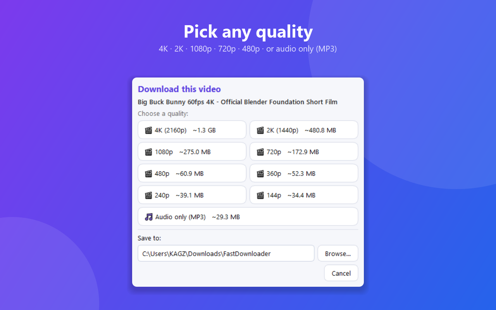
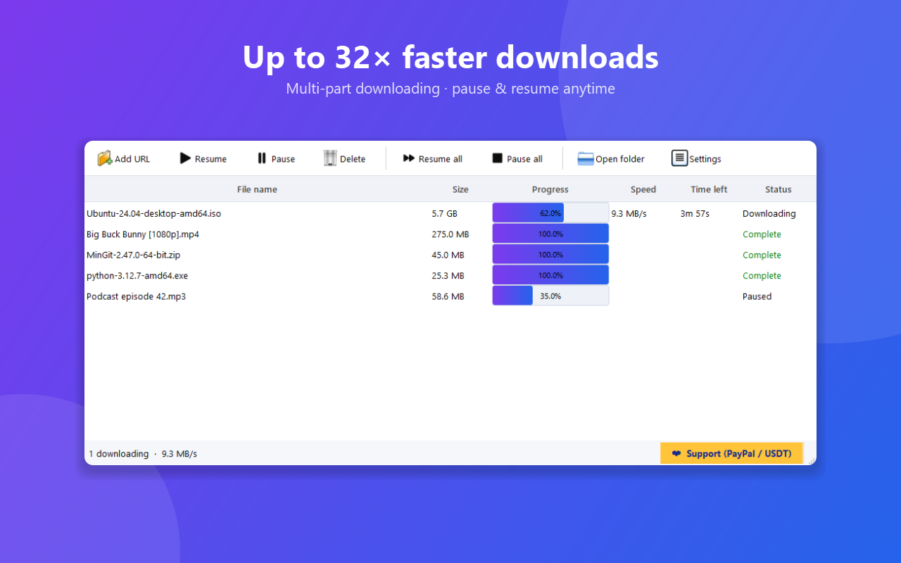
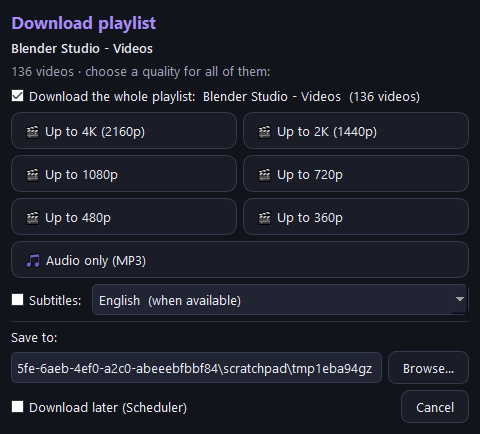
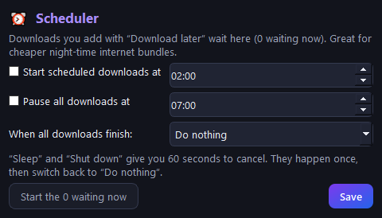

<p align="center">
  
</p>

<h1 align="center">FastDownloader</h1>

<p align="center">
  <b>Free, fast download manager for Windows – files and videos in any quality.</b><br>
  Multi-part downloads · pause &amp; resume · one-click video downloads in 4K, 1080p, 720p, 480p or MP3
</p>

<p align="center">
  <a href="../../releases/latest"><b>⬇ Download the latest version</b></a>
</p>

<p align="center">
  
  
</p>
<p align="center">
  
  
</p>

---

## Features

- **Up to 32× faster downloads** – every file is split into parts that download at the same time.
- **Pause & resume** – even after closing the app or restarting your PC.
- **Video downloads** – YouTube and 1,800+ other sites. A popup shows only the qualities the video really has
  (4K, 2K, 1080p, 720p, 480p …) with file sizes, plus **Audio only (MP3)**.
- **Copy a link → pick a quality** – copy any video link and the quality picker pops up by itself.
- **Whole playlists & channels** – one click downloads every video at the quality you choose, in its own folder.
- **Subtitles** – save subtitles (.srt) in any available language next to the video.
- **Queue, speed limit & scheduler** – choose how many downloads run at once, cap the speed so browsing
  stays fast, start downloads at night and sleep / shut down the PC when everything is finished.
- **Auto folders** – files are sorted into Videos, Music, Programs, Compressed, Documents and Pictures.
- **Dark mode** and **automatic updates**.
- **Browser button** – a *Download* button appears on top of videos in Chrome, Brave and Edge.
- **Catches browser downloads** – exe, zip, rar, iso, apk, pdf, mp4, mp3 … all go to FastDownloader automatically.
  If a link can only be downloaded by the browser, the browser keeps it – nothing gets lost.
- **Plays everywhere** – videos are saved as MP4 (H.264 + AAC where available).
- **No account, no server, no ads** – everything runs on your own PC.

## Install

1. Download **FastDownloader_Setup_1.2.0.exe** from [Releases](../../releases/latest) and run it
   (or take the portable **FastDownloader-1.2-Windows.zip** – no install needed).
   The installed version updates itself when a new version comes out.
   Windows may say *"Windows protected your PC"* – click **More info → Run anyway** (the app is new and not yet code-signed).
2. Add the browser button:
   - open `chrome://extensions` (Brave: `brave://extensions`, Edge: `edge://extensions`)
   - turn on **Developer mode**
   - click **Load unpacked** and choose the **Browser Extension** folder
     (Start menu → FastDownloader → *Browser Extension folder*)
3. Play any video and click **Download** on it – or just copy a video link.

> DRM-protected streaming services (Netflix, Prime Video, Disney+ …) cannot be downloaded.
> Please only download content you have the right to download.

## Support the project ❤

FastDownloader is free. If it saves you time, a small tip keeps it updated:

- **PayPal:** use the *Support* button in the app or the browser extension
- **USDT** – BNB Smart Chain (BEP20, low fees) or Ethereum (ERC20):
  `0x536dd935af551de218b7461d74ab12b42489363f`
  *(send only USDT on these two networks)*

## Build from source

```bat
python -m venv .venv
.venv\Scripts\pip install "yt-dlp[default]" deno PySide6-Essentials requests imageio-ffmpeg qrcode pyinstaller
build.bat
```

The app is written in Python (PySide6), uses [yt-dlp](https://github.com/yt-dlp/yt-dlp) for video sites and ffmpeg for merging video and audio.
